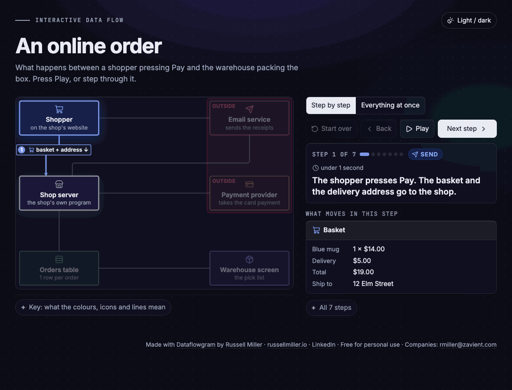
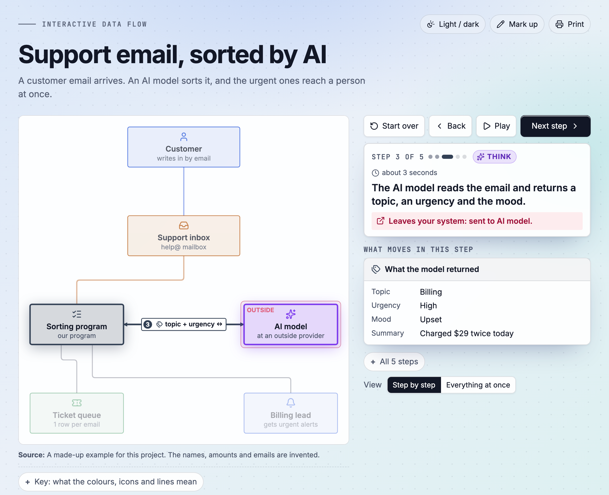

# Dataflowgram

**Interactive data-flow diagrams for any AI agent.** Describe the parts of a system and the steps; your agent builds one page that shows what moves, where it goes, and why, one step at a time.



**Free for personal use. Using it at a company needs a licence: [rmiller@zavient.com](mailto:rmiller@zavient.com).**

**[Open the live examples →](https://russellmiller3.github.io/dataflowgram/)** Press Play, or step through.

## What each step shows

- 🟦 **The line that moves data lights up** in the colour of the part that sends it, with an arrow for the direction.
- 🏷️ **A tag sits on the line** and names what is moving, with an arrow for its direction: "$19.00 card charge →", "2 new rows ↓".
- 🧘 **Calm by default.** Nothing moves until you switch "Moving tags" on; then each tag travels its line. Start over, Back, Play and Next step sit in one row.
- 🗂️ **A side panel shows the real item**: the email, the new row, the request, with its fields.
- 🔴 **Data that leaves your system is flagged**, such as a card sent to a payment provider or an email sent to an AI model.
- 🟡 **"If not" lines** say what happens when a check fails.
- ⏱️ **Times** say how long a step takes.
- 👣 **A trail** keeps earlier steps faintly coloured, so the last step shows the whole path.
- ▶️ **Play** runs the steps by themselves, for a screen share or a demo.
- 🖨️ **Print** gives one page per diagram, turned sideways or upright to suit its shape, with every line named and every step listed below the drawing.
- ✏️ **Mark up** gives a reader 3 marks, drawn straight on any tab: a **Note** (a question, with an optional arrow to the thing it is about), **Move this** (a box with an arrow to where it should go) and **Delete this** (a box with an X). "Save a copy with my notes" gives them the same page as one file with their marks inside, to email back. Nothing to install, and nothing leaves their computer. Your agent then reads each mark and the box it points at.
- 🗺️ **Everything at once** is a still picture: every line lit, every item named on it with its direction, and a list of who sends what to whom, in step order. A line used both ways is drawn as 2 lanes.

Every part has its own colour, and data takes the colour of the part that sends it. No 2 parts joined by a line share a colour, so you can always tell whose data is whose. Every kind of part (a person, a mailbox, a program, an AI model, a table...) and every kind of step (send, read, think, write, reply...) has its own [Lucide](https://lucide.dev) icon.

## Examples

| | |
|---|---|
| [](https://russellmiller3.github.io/dataflowgram/examples/online-order.html) **An online order.** From Pay to the warehouse pick list, with the card payment flagged as leaving the shop's system. | [](https://russellmiller3.github.io/dataflowgram/examples/notes-inbox.html) **A notes inbox with AI.** Forward an email to one address and it is filed; ask a question the same way and the answer comes back. |
| [](https://russellmiller3.github.io/dataflowgram/examples/support-triage.html) **Support email, sorted by AI.** An AI model tags each email, and the urgent ones reach a person at once. | [](https://russellmiller3.github.io/dataflowgram/examples/sign-up.html) **Sign-up with an email check.** The account goes live only when the user clicks the link. |

## Install

**In Claude Code, as a plugin:**

```
/plugin marketplace add russellmiller3/dataflowgram
/plugin install dataflowgram@dataflowgram
```

**Or copy the skill into your skills folder:**

```bash
git clone https://github.com/russellmiller3/dataflowgram.git
cp -r dataflowgram/skills/dataflowgram dataflowgram/skills/khan ~/.claude/skills/
```

**In any other agent** (Codex, Cursor, Gemini CLI and others): point it at `skills/dataflowgram/SKILL.md` (and `skills/khan/SKILL.md` for the explain-anything skill). The skill is one instruction file and one Node.js script, so any agent that can read a file and run a command can use it.

It needs Node.js 18 or later, and nothing else: the icons are stored in the skill, so it works offline.

## Licence

| Who | Price |
|---|---|
| Personal use, hobby projects, study | Free |
| Charities, schools, government | Free |
| Use at or for a company, including freelance client work | Commercial licence: [rmiller@zavient.com](mailto:rmiller@zavient.com) |

Every diagram carries a small credit in its lower right corner, "Made with Dataflowgram by Russell Miller · russellmiller.io · LinkedIn · Free for personal use · Companies: rmiller@zavient.com". The licence asks you to keep it; a commercial licence lets you remove it. The full terms are in [LICENSE](LICENSE): the PolyForm Noncommercial License 1.0.0, with that one added term.

## Use it

Ask your agent in plain words:

> Make an interactive data flow of what happens when a customer pays on our website.

> Show me, step by step, how our support emails get sorted and who sees them.

> Read the checkout folder and draw its data flow. Flag everything that leaves our system.

The agent writes a short description of the parts and steps, checks it, and builds the page.

### Not sure how your process works?

Say so. The agent reads what you already have (code, documents, an email thread), then shows a rough sketch in the chat. It is laid out like the finished page, and it teaches as it goes: one picture (a mailroom) carried through every box, and one real email followed through every step. Each ❓ is a guess. Here is one for a team that files notes by forwarding emails:

```
                              📱
                                ┌────────────────┐
                                │  Sam's phone   │
                                │  (the sender)  │
                                └────────────────┘
                 1) Acme email 📧 ↓ │        ▲ ↑ 8) receipt 🧾 "1 note, 1 task"
                        + Q3.pdf 📄 │        │
                              📥    ▼        │
                                ┌────────────────┐
                                │  Notes inbox   │
                                │(the mail slot) │
                                └────────────────┘
                  2) the email 📧 ↓ │        ▲ ↑ 8) the receipt 🧾
                  ❓ who may send?  ▼        │
                                ┌────────────────┐ 💻                            ┌────────────────┐
                                │    The hub     │─ 4) email text 📝 ───────────▶│    AI model    │
                                │  (the clerk)   │◀───── 5) ✅ "call Dana Fri." ─│(outside reader)│  ⚠️ leaves the company
                                └────────────────┘                            🤖 └────────────────┘
                 6) 2 new rows ➕ ↓ │   ▲      └─ 7) 📄 ──────────┐
                   ❓ which rows?   │   │ ↑ 3) Acme Corp row 📇   │ ↓ 7) Q3.pdf 📄 ❓ where does it go?
                          📋        ▼   │              📁         ▼
                            ┌────────────────┐            ┌────────────────┐
                            │     Lists      │            │  File library  │
                            │(filing cabinet)│            │(folder drawer) │
                            └────────────────┘            └────────────────┘
```

Then it asks at most 3 questions, one per ❓, each with lettered choices:

1. Step 2: who may file a note? **a)** anyone on the team list **b)** anyone at the company's email domain
2. Step 6: which rows get written? **a)** 1 note row only **b)** 1 note row plus 1 task row for each follow-up
3. Step 7: where does the attachment go? **a)** the file library, tagged by company **b)** attached to the note row

You answer "1a 2b 3a". It fixes the sketch, then builds the page.

## Khan: explain anything

The package also installs a second skill, **khan**. Say "khan" or "explain this like Khan Academy" and the agent explains the current topic again in plain words: one picture carried all the way through, one real example followed step by step, a diagram, and the tricky part named out loud. The guess-first sketch above uses the same method.

## Build one by hand

```bash
node skills/dataflowgram/scripts/dataflow.mjs check my-flow.json
node skills/dataflowgram/scripts/dataflow.mjs build my-flow.json my-flow.html
```

Several diagrams for one client or one system go in one page, one tab each. A book file names the title and the diagram files:

```bash
node skills/dataflowgram/scripts/dataflow.mjs book my-book.json my-book.html
```

A book can also carry plain page tabs, such as a plan and timeline or rough screen sketches, so one file can stand in for a slide deck. Name the page's file in the book: `{ "title": "Plan", "htmlFile": "plan.html", "printScale": 0.8 }`. `printScale` shrinks a long tab so it prints on one sheet.

A description is plain JSON. This one is the start of the sign-up example:

```json
{
  "title": "Sign-up with an email check",
  "rows": [["visitor"], ["app", "mailer"], ["users"]],
  "parts": {
    "visitor": { "label": "New user", "kind": "person" },
    "app": { "label": "App server", "kind": "program" },
    "mailer": { "label": "Email service", "kind": "outside" },
    "users": { "label": "Users table", "kind": "store" }
  },
  "lines": [["visitor", "app"], ["app", "mailer"], ["mailer", "visitor"], ["app", "users"]],
  "scenarios": [{
    "id": "signup", "label": "Sign up and confirm",
    "steps": [
      { "action": "send", "flow": ["visitor>app"], "text": "The new user fills in the form.",
        "carry": { "icon": "id-card", "label": "name + email" },
        "item": { "title": "Sign-up form", "fields": [["Name", "Ana Ruiz"], ["Email", "ana@example.com"]] } },
      { "action": "send", "flow": ["app>mailer"], "text": "The app asks the email service to send a confirm link.",
        "carry": { "icon": "link", "label": "confirm link" } }
    ]
  }]
}
```

The full list of fields is in [the skill's instructions](skills/dataflowgram/SKILL.md). The check refuses a description with a fault and names it: a label too long for its box, a step on a line that does not exist, an icon that is not in the set.

**Link to one step** by adding `#df=<scenario>.<step>` to the page address, such as `online-order.html#df=paid.2`.

## Tests

```bash
npm test
```

21 tests step through scenarios and check which line lights and in which direction, the trail, the leaving warning, the side panel, links to a step, that boxes never overlap, that text from a description cannot break the page, and that every wrong description is refused.

## Credits

Icons: [Lucide](https://lucide.dev), ISC licence ([copy](skills/dataflowgram/assets/LUCIDE-LICENSE.txt)). The skill: PolyForm Noncommercial 1.0.0 with a credit term ([LICENSE](LICENSE)).

---

**Made by Russell Miller.** I build AI products and the systems behind them, and I'm available for product management work.
[russellmiller.io](https://russellmiller.io) · [zavient.com](https://zavient.com) · [rmiller@zavient.com](mailto:rmiller@zavient.com)
