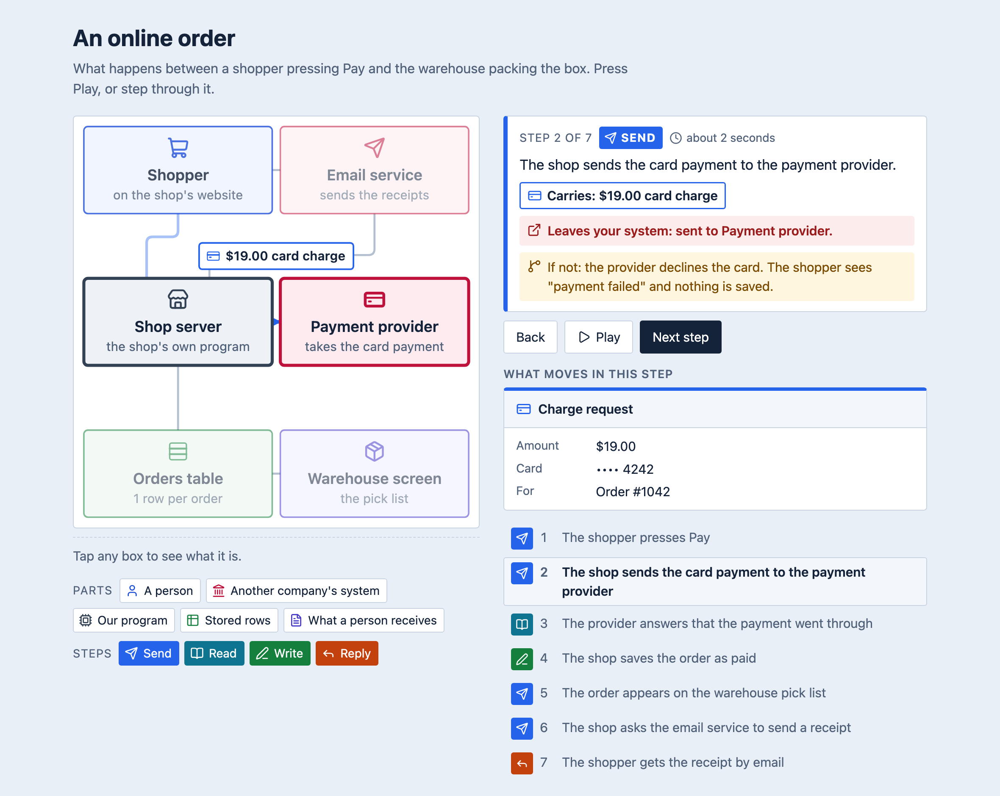
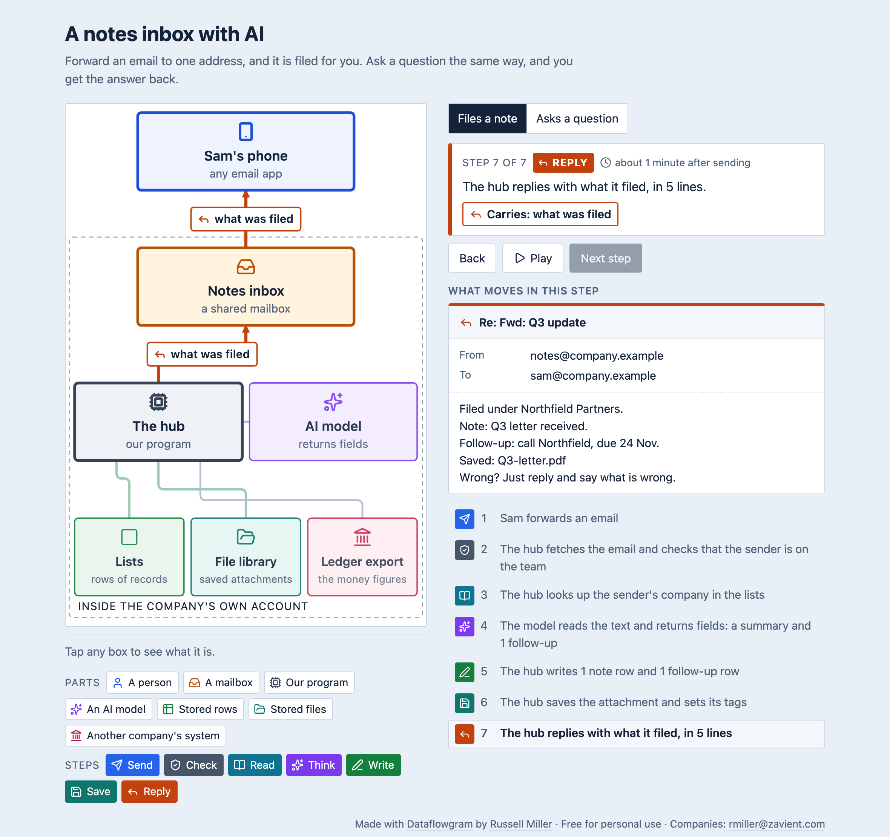
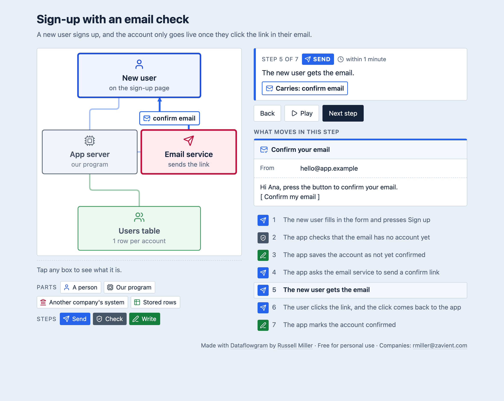

# Dataflowgram

**Interactive data-flow diagrams for Claude.** Describe the parts of a system and the steps; Claude builds one page that shows what moves, where it goes, and why, one step at a time.


**Free for personal use. Using it at a company needs a licence: [rmiller@zavient.com](mailto:rmiller@zavient.com).**

**[Open the live examples →](https://russellmiller3.github.io/dataflowgram/)** Press Play, or step through.

## What each step shows

- 🟦 **The line that moves data lights up** in the step's colour, with an arrow for the direction.
- 🏷️ **A tag rides the line** and names what is moving: "$19.00 card charge", "2 new rows", "confirm link".
- 🗂️ **A side panel shows the real item**: the email, the new row, the request, with its fields.
- 🔴 **Data that leaves your system is flagged**, such as a card sent to a payment provider or an email sent to an AI model.
- 🟡 **"If not" lines** say what happens when a check fails.
- ⏱️ **Times** say how long a step takes.
- 👣 **A trail** keeps earlier steps faintly coloured, so the last step shows the whole path.
- ▶️ **Play** runs the steps by themselves, for a screen share or a demo.

Every kind of part (a person, a mailbox, a program, an AI model, a table...) and every kind of step (send, read, think, write, reply...) has its own colour and [Lucide](https://lucide.dev) icon.

## Examples

| | |
|---|---|
| [](https://russellmiller3.github.io/dataflowgram/examples/online-order.html) **An online order.** From Pay to the warehouse pick list, with the card payment flagged as leaving the shop's system. | [](https://russellmiller3.github.io/dataflowgram/examples/notes-inbox.html) **A notes inbox with AI.** Forward an email to one address and it is filed; ask a question the same way and the answer comes back. |
| [](https://russellmiller3.github.io/dataflowgram/examples/support-triage.html) **Support email, sorted by AI.** An AI model tags each email, and the urgent ones reach a person at once. | [](https://russellmiller3.github.io/dataflowgram/examples/sign-up.html) **Sign-up with an email check.** The account goes live only when the user clicks the link. |

## Install

**As a Claude Code plugin:**

```
/plugin marketplace add russellmiller3/dataflowgram
/plugin install dataflowgram@dataflowgram
```

**Or copy the skill into your skills folder:**

```bash
git clone https://github.com/russellmiller3/dataflowgram.git
cp -r dataflowgram/skills/dataflowgram ~/.claude/skills/
```

It needs Node.js 18 or later, and nothing else: the icons are stored in the skill, so it works offline.

## Licence

| Who | Price |
|---|---|
| Personal use, hobby projects, study | Free |
| Charities, schools, government | Free |
| Use at or for a company, including freelance client work | Commercial licence: [rmiller@zavient.com](mailto:rmiller@zavient.com) |

Every diagram carries a small credit in its lower right corner, "Made with Dataflowgram by Russell Miller · Free for personal use · Companies: rmiller@zavient.com". The licence asks you to keep it; a commercial licence lets you remove it. The full terms are in [LICENSE](LICENSE): the PolyForm Noncommercial License 1.0.0, with that one added term.

## Use it

Ask Claude in plain words:

> Make an interactive data flow of what happens when a customer pays on our website.

> Show me, step by step, how our support emails get sorted and who sees them.

Claude writes a short description of the parts and steps, checks it, and builds the page.

## Build one by hand

```bash
node skills/dataflowgram/scripts/dataflow.mjs check my-flow.json
node skills/dataflowgram/scripts/dataflow.mjs build my-flow.json my-flow.html
```

A description is plain JSON. This one is the start of the sign-up example:

```json
{
  "title": "Sign-up with an email check",
  "rows": [["visitor"], ["app", "mailer"], ["users"]],
  "parts": {
    "visitor": { "label": "New user", "kind": "person" },
    "app": { "label": "App server", "kind": "program" },
    "mailer": { "label": "Email service", "kind": "outside" },
    "users": { "label": "Users table", "kind": "store" }
  },
  "lines": [["visitor", "app"], ["app", "mailer"], ["mailer", "visitor"], ["app", "users"]],
  "scenarios": [{
    "id": "signup", "label": "Sign up and confirm",
    "steps": [
      { "action": "send", "flow": ["visitor>app"], "text": "The new user fills in the form.",
        "carry": { "icon": "id-card", "label": "name + email" },
        "item": { "title": "Sign-up form", "fields": [["Name", "Ana Ruiz"], ["Email", "ana@example.com"]] } },
      { "action": "send", "flow": ["app>mailer"], "text": "The app asks the email service to send a confirm link.",
        "carry": { "icon": "link", "label": "confirm link" } }
    ]
  }]
}
```

The full list of fields is in [the skill's instructions](skills/dataflowgram/SKILL.md). The check refuses a description with a fault and names it: a label too long for its box, a step on a line that does not exist, an icon that is not in the set.

**Link to one step** by adding `#df=<scenario>.<step>` to the page address, such as `online-order.html#df=paid.2`.

## Tests

```bash
npm test
```

21 tests step through scenarios and check which line lights and in which direction, the trail, the leaving warning, the side panel, links to a step, that boxes never overlap, that text from a description cannot break the page, and that every wrong description is refused.

## Credits

Icons: [Lucide](https://lucide.dev), ISC licence ([copy](skills/dataflowgram/assets/LUCIDE-LICENSE.txt)). The skill: PolyForm Noncommercial 1.0.0 with a credit term ([LICENSE](LICENSE)).

---

**Made by Russell Miller.** I build AI products and the systems behind them, and I'm available for product management work.
[russellmiller.io](https://russellmiller.io) · [zavient.com](https://zavient.com) · [rmiller@zavient.com](mailto:rmiller@zavient.com)
